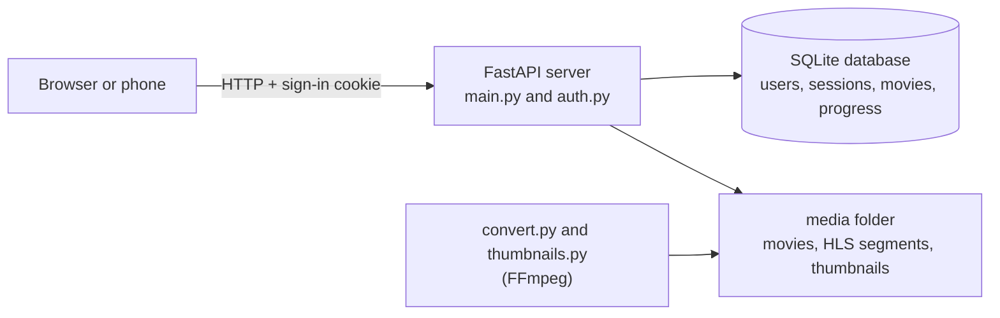

# HomeStream

A private streaming server for your own movie collection. Run it on a laptop, and your family can watch from their phones, at home or away, with accounts, adaptive video quality and "continue watching".


## Why I built it

Streaming a movie over mobile data uses a lot of it. I wanted my family to watch movies I already had, without paying for another service and without burning through their data plans. So I turned a laptop into a server that watches over a private connection and adjusts the video quality to the connection, down to a small 360p version when the signal is weak.

Along the way I built every layer: a web server, a streaming API, a video converter, a login system, a database and a secure way to reach it from outside the house. (with AI assiatance just to learn how things work).

## Features

- **Streaming with seeking.** Videos are sent in small pieces (HTTP range requests), so jumping to the middle of a film is instant.
- **Adaptive quality.** Movies are converted with FFmpeg into several resolutions (HLS), and the player switches between them automatically. Viewers can also pick a quality, for example 360p to save data.
- **Accounts and sign-in.** The admin creates accounts for family members. Passwords are stored as scrypt hashes, sessions use secure cookies, and repeated wrong passwords lock the login for a while.
- **Everything is protected.** Movie lists, thumbnails and the video files themselves all need a signed-in account.
- **Continue watching.** Each person has their own history. Movies resume where they stopped, on any device, and finished movies are marked as watched.
- **Thumbnails.** A picture from each movie is picked automatically.
- **Works on phones.** The page adapts to small screens and follows the phone's light or dark mode.
- **Private remote access.** Works with Tailscale, so nothing is opened on your router.
- **Tested.** An automated test suite covers sign-in rules, protection of video files, streaming, watch progress and SQL safety.

## How it works



1. `convert.py` uses FFmpeg to cut each movie into 6 second pieces at several qualities, plus a playlist that lists them.
2. `thumbnails.py` grabs one representative frame from each movie.
3. The server (FastAPI) checks the sign-in cookie on every request, serves the web page, the movie list and the video pieces, and records how far each person has watched.
4. The page uses hls.js to play the pieces and to switch quality, and it saves the watch position every ten seconds of playback.

## Getting started

You need **Python 3.10 or newer** and **FFmpeg**. On Windows:

```powershell
winget install Python.Python.3.12
winget install Gyan.FFmpeg
```

Then set up the project (reopen the terminal after installing, so the new programs are found):

```powershell
git clone https://github.com/YOUR_USERNAME/homestream.git
cd homestream
python -m venv venv
venv\Scripts\activate
pip install -r requirements.txt
```

On macOS or Linux, activate with `source venv/bin/activate` instead.

Add some video files (mp4, mkv, webm, mov or avi) to `media/movies`. Each movie can sit in its own folder named like `Inception (2010)`, which helps the title and year come out cleanly.

```powershell
python convert.py            # make the adaptive quality versions (slow, run it once per new movie)
python thumbnails.py         # make the cover pictures
python start.py --local-only # start the server for this laptop only
```

Open `http://localhost:8000` and create the first account. It becomes the admin. Then stop the server with Ctrl+C and start it for your network:

```powershell
python start.py
```

The launcher prints the addresses to open on a phone. On Windows you can also double-click `start.bat`.

### Options

| Command | What it does |
| --- | --- |
| `python start.py --port 8080` | Use another port (or change `DEFAULT_PORT` in `start.py`) |
| `python start.py --local-only` | Only this laptop can connect |
| `python start.py --reload` | Restart when code changes (development) |
| `python convert.py --max-height 1080` | Also make a 1080p version (default is 720p) |
| `python convert.py --encoder qsv` | Use Intel Quick Sync for faster conversion (if your graphics driver supports it) |
| `python convert.py --force` | Convert movies again |
| `python thumbnails.py --at 25` | Take the picture 25% into each movie |

A movie that hasn't been converted still plays, using the original file.

## Watching away from home

HomeStream does not use HTTPS by itself, so it should not be exposed directly to the internet. The setup I use is [Tailscale](https://tailscale.com), a free private network between devices:

1. Install Tailscale on the laptop and on each viewer's phone.
2. Share the laptop with each viewer from the Tailscale admin console.
3. They open `http://<laptop's Tailscale address>:8000` and sign in with their HomeStream account.

Only people you have shared the laptop with can even reach the server, and the traffic between devices is encrypted. Do not use router port forwarding for this.

## Security notes

- Passwords are hashed with scrypt and a random salt, and compared in constant time.
- Sign-in uses a random session token in an `HttpOnly`, `SameSite=Lax` cookie. Only a hash of the token is stored in the database.
- Every request under `/api`, `/hls` and `/thumbs` is checked by one middleware, so the video files are protected too.
- All database queries use placeholders, so input can never run as SQL.
- Progress is always saved for the signed-in person, never for a user id sent in the request.
- The first account can only be created from the laptop itself.
- Unknown users and wrong passwords give the same message, and take about the same time.
- Real file paths are never sent to the browser.

Known limits: the plain `http` connection is not encrypted on a local network, so only use it on networks you trust, and the failed sign-in counter lives in memory, so it resets when the server restarts.

## API

| Route | Who | Purpose |
| --- | --- | --- |
| `GET /`, `GET /api/health` | Anyone | The web page, and a health check |
| `GET /api/auth/status`, `POST /api/auth/setup`, `POST /api/auth/login` | Anyone | Check if setup is needed, create the first account, sign in |
| `POST /api/auth/logout`, `GET /api/auth/me`, `POST /api/auth/password` | Signed in | Sign out, who am I, change password |
| `GET /api/users`, `POST /api/users`, `DELETE /api/users/{id}` | Admin | Manage family accounts |
| `GET /api/movies?search=`, `GET /api/movies/{id}` | Signed in | The library, with this person's progress |
| `GET /api/continue` | Signed in | Unfinished movies, most recent first |
| `PUT /api/progress/{id}` | Signed in | Save where the person stopped |
| `GET /api/stream/{id}` | Signed in | The original file, with range requests |
| `/hls/{id}/master.m3u8`, `/thumbs/{id}.jpg` | Signed in | Adaptive stream and thumbnail |

When the server is running, interactive API docs are at `/docs`.

## Tests

```powershell
pip install -r requirements-dev.txt
python -m pytest
```

The tests use a temporary database and movies folder, so they never touch your real data. A deprecation warning about `httpx` from Starlette's test client is harmless.

## Project structure

```
homestream/
    main.py             web server routes, library sync, streaming, watch progress
    auth.py             accounts, password hashing, sessions, the sign-in gatekeeper
    db.py               SQLite connection and table definitions
    convert.py          FFmpeg: movies into adaptive HLS streams
    thumbnails.py       FFmpeg: one cover picture per movie
    start.py            launcher that prints the addresses to open
    start.bat           double-click launcher for Windows
    static/             the web page (index.html, style.css, app.js, hls.min.js)
    media/              your movies, converted streams and thumbnails (not in git)
    tests/              automated tests
```

## What I learned

- How servers, clients, IP addresses, ports and DNS fit together
- How video streaming really works: range requests, segments, playlists and adaptive bitrate
- Storing passwords safely, and why a session cookie is a better fit than a token for video
- Designing a small database with keys, joins and cascading deletes
- Why you check permissions on the server, never in the page
- Keeping a home server private with a mesh VPN instead of opening ports

## Ideas for later

- A "data saver" switch that always starts at the lowest quality
- Removing a movie from "continue watching"
- Subtitles and multiple audio tracks
- Scanning a QR code to open the site on a phone
- Starting the server automatically when Windows starts

## Third party software and content

- [hls.js](https://github.com/video-dev/hls.js) (Apache License 2.0) is included as `static/hls.min.js`. The original project has its full license text.
- [FFmpeg](https://ffmpeg.org) is used for conversion and is not included.
- Screenshots use open licensed films from the [Blender Foundation](https://studio.blender.org/films/), such as Big Buck Bunny and Sintel.

## License

MIT, see [LICENSE](LICENSE).
